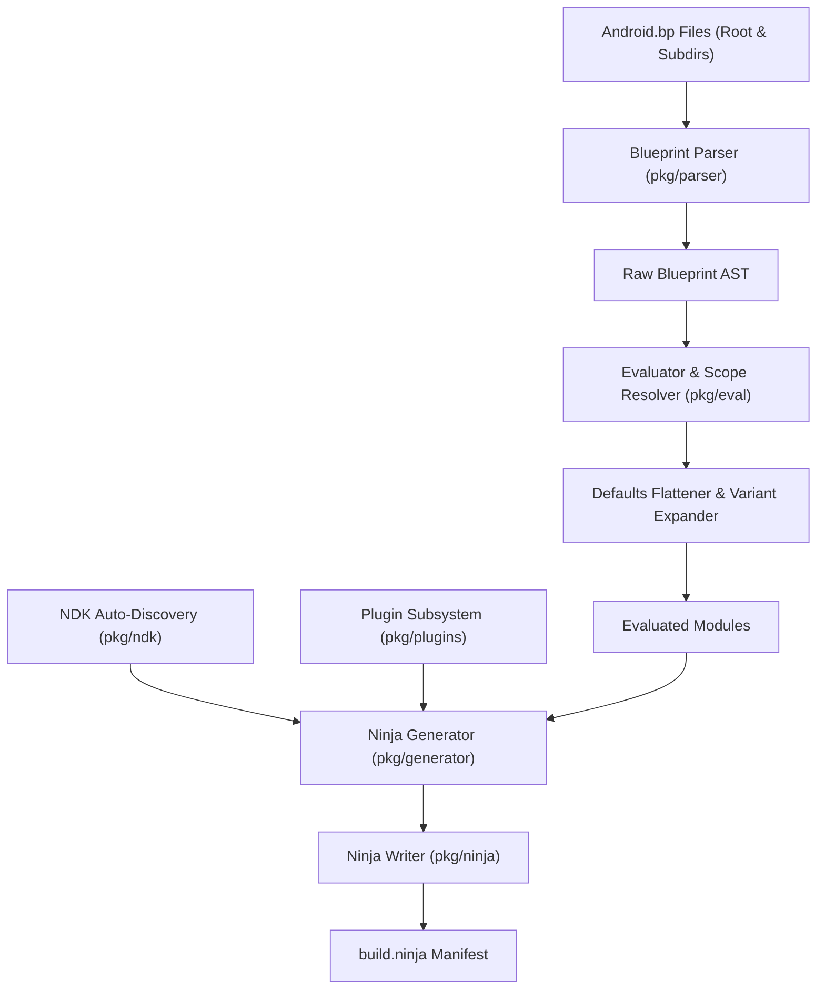

# bp2ninja Technical Architecture

This document describes the internal design, compiler architecture, AST pipeline, and code generation mechanisms of **bp2ninja**.

---

## Table of Contents

- [Architectural Overview](#architectural-overview)
- [Compilation Pipeline](#compilation-pipeline)
- [Blueprint Lexer & Parser (`pkg/parser`)](#blueprint-lexer--parser-pkgparser)
- [AST Evaluation & Scope Resolution (`pkg/eval`)](#ast-evaluation--scope-resolution-pkgeval)
  - [Variable Resolution & Scopes](#variable-resolution--scopes)
  - [Defaults Flattening & Inheritance](#defaults-flattening--inheritance)
  - [Target, Architecture & Multilib Expansion](#target-architecture--multilib-expansion)
  - [Host vs. Target Mode Handling](#host-vs-target-mode-handling)
- [Ninja Generator Engine (`pkg/generator`)](#ninja-generator-engine-pkggenerator)
  - [Dual-Variant Library Synthesis (`cc_library`)](#dual-variant-library-synthesis-cc_library)
  - [Protobuf (`protoc`) Code Generation Pipeline](#protobuf-protoc-code-generation-pipeline)
  - [AConfig (`cc_aconfig_library`) Synthesis](#aconfig-cc_aconfig_library-synthesis)
  - [Two-Stage Kotlin & Java Compilation](#two-stage-kotlin--java-compilation)
  - [Granular `gensrcs` & `genrule` Synthesis](#granular-gensrcs--genrule-synthesis)
  - [Linker Arguments & Dependency Checking Bypass](#linker-arguments--dependency-checking-bypass)
- [Android NDK Auto-Discovery (`pkg/ndk`)](#android-ndk-auto-discovery-pkgndk)
- [Modular Plugin Architecture (`pkg/plugins`)](#modular-plugin-architecture-pkgplugins)

---

## Architectural Overview

`bp2ninja` is constructed as a modern multi-stage compiler:

---

## Compilation Pipeline

1. **Discovery & Ingestion**:
   - Reads the primary `Android.bp`.
   - Recursively traverses subdirectories (via `generator.DiscoverBpFiles`) to discover all nested Blueprint files in the tree.
2. **Lexing & Parsing (`pkg/parser`)**:
   - Parses tokens into clean abstract syntax tree structures without relying on external Blueprint libraries.
3. **Evaluation (`pkg/eval`)**:
   - Evaluates variable declarations and local expressions.
   - Flattens multi-tier chained `defaults` (e.g. `cc_defaults`).
   - Expands architectural blocks (`arch`, `target`, `multilib`).
4. **Toolchain Resolution (`pkg/ndk`)**:
   - Resolves target Clang compilers, sysroots, and API levels from the Android NDK.
5. **Rule & Edge Generation (`pkg/generator`)**:
   - Emits compilation rules, object compile edges, linker commands, codegen actions, and order-only dependencies.
6. **Serialization (`pkg/ninja`)**:
   - Emits a standard, highly optimized `build.ninja` manifest.

---

## Blueprint Lexer & Parser (`pkg/parser`)

The parser is self-contained in `pkg/parser`:
- **Lexer**: Scans Blueprint tokens, string literals, list expressions, map dictionaries, identifiers, and comments.
- **AST Node Types**:
  - `File`: Represents an entire parsed Blueprint file.
  - `Assignment`: Variable bindings (`var = value` or `var += value`).
  - `Module`: Blueprint module definitions (`type { prop: val }`).
  - `Property`: Key-value pairs inside modules or nested maps.
  - `Expression`: Literal strings, integers, booleans, lists, and operators.
- **Printer & Modifier**: Allows round-trip parsing, AST modification, and formatting.

---

## AST Evaluation & Scope Resolution (`pkg/eval`)

The evaluation package converts raw AST structures into strongly typed `EvaluatedModule` representations.

### Variable Resolution & Scopes

Variables defined at file scope (e.g. `common_cflags = ["-Wall"]`) are stored in an evaluation `Scope`. When a module references an identifier, the evaluator resolves and interpolates the expression.

### Defaults Flattening & Inheritance

In Soong, modules frequently inherit properties via `defaults: ["..."]`.
- `bp2ninja` resolves defaults chains in left-to-right order.
- To avoid mutating shared parent defaults across sibling modules, `bp2ninja` performs **deep property cloning** (`cloneProperty`).
- Path properties (such as `local_include_dirs`, `srcs`, `export_include_dirs`) declared in defaults residing in parent directories are recursively adjusted to the child module's relative working directory.

### Target, Architecture & Multilib Expansion

Properties inside conditional blocks are expanded based on the requested target architecture:
- `arch.<name>`: Expanded if `<name>` matches `-arch` (e.g. `arch.arm64`).
- `multilib.lib64` / `multilib.lib32`: Expanded based on whether the architecture is 64-bit or 32-bit.
- `target.android` / `target.host`: Applied according to whether target or `-host` mode is active.

### Host vs. Target Mode Handling

When `-host` is enabled:
- `host: {}` blocks are unpacked and merged into module properties.
- `target.host`, `target.linux`, and `target.linux_glibc` are applied.
- Device-specific modules (`android_app`, device-only `cc_library`) are disabled unless `host_supported: true` or `host_available: true` is set.
- Target NDK cross-compilation is bypassed in favor of host `$CC` and `$CXX`.

---

## Ninja Generator Engine (`pkg/generator`)

The generator translates evaluated modules into concrete Ninja build actions.

### Dual-Variant Library Synthesis (`cc_library`)

When encountering a `cc_library` module, `bp2ninja` generates both targets:
1. **Shared Library (`.so`)**:
   - Emits a `link_shared` rule linking objects into `out/lib64/lib<name>.so`.
2. **Static Library (`.a`)**:
   - Emits an `archive_static` rule running `$ar rcs` to produce `out/lib64/lib<name>.a`.
3. **Optimized Compilation Pass**:
   - If sources and compiler flags between static and shared builds are identical, compilation edges are generated **once** (`out/obj/<name>/`).
   - If sources or flags diverge (e.g. `static: { srcs: [...] }`), compilation is split into `out/obj/<name>.shared/` and `out/obj/<name>.static/`.

### Protobuf (`protoc`) Code Generation Pipeline

For `.proto` files in `srcs`:
- Generates a dedicated `protoc` build edge.
- Preserves relative subpath directory structures (e.g. `protos/foo.proto` $\to$ `out/gen/<mod>/protos/foo.pb.{cc,h}`).
- Automatically injects `-Iout/gen/<mod>` and subdirectories into module includes.
- Transitive export: Any module referencing this library (`shared_libs`, `static_libs`, `header_libs`) automatically inherits `-Iout/gen/<mod>`.
- Order-only dependencies: Attaches `|| out/gen/<mod>/...pb.h` to all `.o` compile edges to prevent race conditions during parallel builds.
- Supports ABI pinning via the `$PROTOC` environment variable.

### AConfig (`cc_aconfig_library`) Synthesis

Implements Android 14+ feature flag C++ library generation:
- Resolves upstream `aconfig_declarations` dependencies.
- Discovers `.aconfig` and `.values` input files.
- Generates a `rule aconfig_create_cpp_lib` edge producing C++ code under `out/gen/<name>/`.
- Compiles generated code into a static library archive and exports `-Iout/gen/<name>/include`.

### Two-Stage Kotlin & Java Compilation

Handles Java and Kotlin source trees:
1. **Source Partitioning**: Inspects `srcs` and divides files into `.kt` and `.java`.
2. **Pure Kotlin**: Emits `kotlinc_compile` rules invoking `$kotlinc` followed by `$jar`.
3. **Pure Java**: Emits `javac_compile` rules invoking `$javac` followed by `$jar`.
4. **Mixed Kotlin + Java**: Orchestrates a two-stage compile edge (`kotlin_java_compile`):
   - Stage 1: `kotlinc` compiles Kotlin sources while referencing Java sources for cross-language symbols.
   - Stage 2: `javac` compiles Java sources against the Kotlin class directory.
   - Stage 3: `$jar cf` bundles bytecode into the final output JAR.
5. **Platform SDK Resolution**: Resolves `:current_android_jar` and `:system_android_jar` to `<SDK>/platforms/android-<API>/android.jar`.

### Granular `gensrcs` & `genrule` Synthesis

- **`gensrcs`**: Generates independent, per-source Ninja build edges according to `output_extension`.
- **Consumer Wiring**: Consumers referencing `:gensrcs_name` resolve targets directly from `g.moduleOutputs`. Consumers declaring `generated_headers` receive exported include paths and order-only header dependencies.
- **Data Dependencies**: `data: [...]` inputs are tracked as implicit prerequisites.

### Linker Arguments & Dependency Checking Bypass

Instead of requiring 1,500 checked-out repositories:
- Mapped library references (`shared_libs`, `static_libs`) are translated into direct `-l<lib>` flags.
- Linker search paths are pointed to `-Lout/lib64` and `-L<prebuilt-libs>`.
- Missing internal dependencies receive generated phony rules when `-allow-missing-deps` is true.

---

## Android NDK Auto-Discovery (`pkg/ndk`)

The `pkg/ndk` package scans standard locations for Android NDK installations:
1. Explicit paths passed via `-ndk <path>`.
2. Environment variable `$ANDROID_NDK`.
3. Google Android Studio installations: `~/Android/Sdk/ndk/*`.
4. Distribution packages: `/opt/android-ndk`, `/opt/android-ndk-beta`.

For each candidate, it parses `source.properties`, extracts major version numbers, verifies Clang toolchain binaries, and configures target triples (`aarch64-linux-android<API>`, `x86_64-linux-android<API>`).

---

## Modular Plugin Architecture (`pkg/plugins`)

While AST auto-derivation translates most custom Soong rules, `bp2ninja` supports dynamic Go `.so` plugins:
- Plugins register handlers for specific Blueprint module types.
- Auto-discovery checks `/usr/lib/bp2ninja/plugins/`, `/usr/local/lib/bp2ninja/plugins/`, and `$BP2NINJA_PLUGINS_DIR`.
- In-tree Soong Go rules can be converted into `bp2ninja` plugins via `bp2ninja convert-plugin`.
